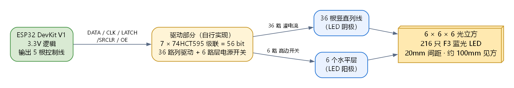
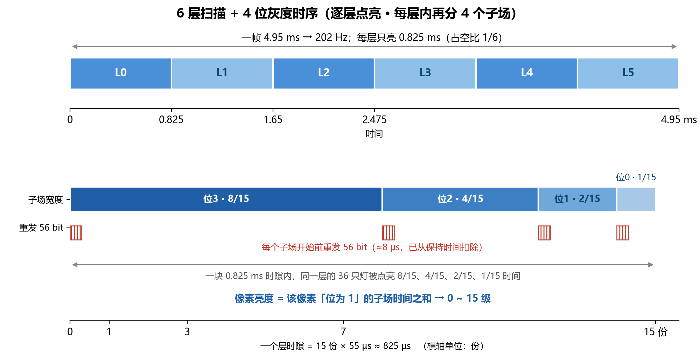

# 01 · 原理与接口

## 1. 坐标与命名

```
        z = 5   ← 最上层
        ...
        z = 1
        z = 0   ← 最下层（贴底座）
             y = 0 … 5   （前后）
        x = 0 … 5       （左右）
```

- **列**：竖直穿过 6 层的一根线，位置 (x, y)，共 **36 根**，接的是 LED 的 **阴极**。
- **层**：一整个水平面，共 **6 层**，接的是 LED 的 **阳极**。
- 软件里 `lum[z][x][y]` 是一个 0–15 的亮度值。



---

## 2. 为什么正好是 42 路

如果每只灯单独拉线，需要 216 根。利用两个共用关系可以压到 42 根：

| 共用方式 | 结果 |
|:--|:--|
| 同一条竖线上的 6 只灯共用阴极 → 36 根列线 | 216 → 36 + 6×6 层控制 |
| 同一层的 36 只灯共用阳极 → 6 条层线 | 得到 36 + 6 = **42** |

代价是**不能同时点亮不同层的任意两只灯**：只有一层通电时，列线上送什么，那一层就亮什么。
所以必须**逐层扫描**。

---

## 3. 扫描原理



一个**层时隙**里做三件事：

1. 把这一层的 36 位列数据 + 1 个层选择位，共 **42 bit**（实际按 56 bit 发送，见 5.2）串行移入移位链；
2. 打一个 **LATCH** 脉冲，输出同时更新；
3. 保持一段时间，然后切下一层。

6 层走完 = 一帧 **4.95 ms ≈ 202 Hz**。人眼看不到这个频率的闪烁，看到的是整幅立体图像。

> 人眼对 1/6 占空比的感知大致是峰值亮度的 1/3，所以 20 mA 峰值看起来接近静态 7 mA 的效果。

### 3.1 每只灯的亮度（4 位灰度）

每只灯除了“亮/灭”，还可以有 **0–15 共 16 级亮度**。做法是在每个层时隙内部再切 **4 个子场**，
子场持续时间按二进制权重 **8 : 4 : 2 : 1** 分配：

| 子场 | 权重 | 时长（55 µs/份） | 点亮条件 |
|:--|:--:|:--:|:--|
| 位 3（最高） | 8/15 | ≈ 440 µs | 亮度值的 bit3 = 1 |
| 位 2 | 4/15 | ≈ 220 µs | bit2 = 1 |
| 位 1 | 2/15 | ≈ 110 µs | bit1 = 1 |
| 位 0（最低） | 1/15 | ≈ 55 µs | bit0 = 1 |

一只灯在整帧里的累计点亮时间 = 它亮度值对应的权重之和，所以亮度 0–15 是**线性**的。
每层 15 份 × 55 µs ≈ 825 µs，整帧约 4.95 ms，**刷新率约 202 Hz**。

> 子场之间不需要熄灭：移数据时上一子场继续亮，LATCH 的瞬间整体切换，不会产生鬼影。
> 每次移位约 8 µs，固件会自动测量并从保持时间里扣除，保证 8:4:2:1 的比例准确。

---

## 4. 电气参数（驱动需要满足的要求）

> 这一节是**要求**，不是电路设计。驱动怎么做由你决定。

### 4.1 单只 LED

| 参数 | 值 |
|:--|:--|
| 型号 | F3（3 mm）蓝光，透明/雾状均可 |
| 正向压降 Vf | 3.0 – 3.4 V @ 20 mA（按批次测） |
| 峰值电流（1/6 占空比） | 建议 20 – 30 mA |
| 平均电流 | 3.3 – 5.0 mA |
| 极性 | **长脚 = 阳极 (+)**，短脚 = 阴极 (−)，灯体平边 = 阴极 |

### 4.2 线路与整机电流

| 项目 | 数值 |
|:--|:--|
| 列线（阴极，36 路） | 每路任何时刻只流过 **1 只** LED 的电流（≤ 30 mA） |
| 层线（阳极，6 路） | 每层 36 只 × 峰值电流 = **0.72 A**（20 mA）/ **1.08 A**（30 mA） |
| 整机 LED 平均电流 | 同一时刻只有一层通电 → **约 0.72 – 1.08 A** |
| ESP32 | 0.12 A（空闲）– 0.24 A（WiFi 峰值） |
| **5 V 电源总需求** | **0.85 – 1.3 A**，取 5 V / 2 A 以上，推荐 5 V / 3 A |
| 逻辑电平 | 输入必须兼容 **3.3 V 高电平**（用 74HCT 系列，不要 74HC） |
| 共地 | ESP32 与驱动、电源必须共地 |

### 4.3 压降

- 5 V 供电时留给 LED + 限流的余量只有 1 V 左右，**限流电阻按实测 Vf 配**。
- 层开关在 0.72–1.08 A 下压降越小越好（MOS 优于三极管），否则亮度会随层变化。

---

## 5. 接口协议（驱动必须照这个做）

### 5.1 五根信号线

| 信号 | ESP32 引脚 | 方向 | 说明 |
|:--|:--:|:--:|:--|
| DATA | GPIO 23 | → 驱动 | 串行数据，接第一片 595 的 SER |
| CLK  | GPIO 18 | → 驱动 | 移位时钟，接所有 595 的 SRCLK（上升沿移入） |
| LATCH| GPIO 5  | → 驱动 | 锁存，接所有 595 的 RCLK（上升沿更新输出） |
| /SRCLR | GPIO 17 | → 驱动 | 低有效，清零移位寄存器（H9-9） |
| /OE  | GPIO 16 | → 驱动 | 低有效，输出使能（高 = 高阻，H9-10） |

### 5.2 移位链

```
ESP32 ──DATA──> U1(层) ──Q7'──> U2(第0行) ──> U3(第1行) ──> … ──> U7(第5行)
CLK / LATCH / SRCLR / OE 五根线并联到全部 7 片
```

一共 **7 × 8 = 56 bit**，其中实际用到 42 bit：

| 寄存器 | 用到的位 | 含义 |
|:--|:--|:--|
| U1 层寄存器 | **Q1 – Q6**（bit1 – bit6） | 第 z 层接 Q(z+1) |
| U2 – U7 行寄存器 | **Q1 – Q6**（bit1 – bit6） | 该行 y 的 6 根列，列 (x, y) 接 Q(x+1) |
| 其余 | Q0、Q7（bit0、bit7） | 没有用到，恒为 0 |

> 实际驱动板只用了 Q1–Q6，Q0 空着（原理图上 U1–U7 的 Q0 引脚悬空）。固件对应写成
> `1u << (x + 1)` 和 `1u << (z + 1)`。

固件的发送顺序是：

```
行5, 行4, 行3, 行2, 行1, 行0, 层
```

> 先送出的字节会停在链尾，所以 U7 收到行5、U1 收到层字节。
> 如果你的链序不同，只需改固件里 `renderPlane()` 的发送顺序，见 `03_固件与使用.md`。

### 5.3 极性约定

| 位 | = 0 | = 1 |
|:--|:--|:--|
| 列位 | 该列关断 | 该列**导通**（阴极被拉到地，经 ULN 反相） |
| 层位 | 该层**阳极加电** | 该层断电 |

**为什么层是“0 = 亮”**：层用 P 沟道 MOS（AO3401A）做高边开关，源极接 5 V，
595 输出经 1 kΩ 直接驱动栅极 —— 输出 **低** 时栅极被拉低、Vgs = −5 V 才导通；
输出高时 Vgs = 0 关断。10 kΩ 上拉到 5 V 保证 MCU 没初始化时层全部关断。

所以固件送层字节时是「除当前层外全 1」（`0x7E & ~(1<<(z+1))`），见 `renderPlane()`。
列字节仍然是 1 = 亮（ULN2803 本身是反相器）。

> 上电瞬间 /SRCLR 清零后 595 输出全 0，6 层会全部导通；但列全 0，没有电流通路，
> 所以仍然是全灭，符合第 5.5 节的上电顺序。

### 5.4 时序

| 时序项 | 值 |
|:--|:--|
| 每个层时隙 | 0.825 ms（15 份 × 55 µs） |
| 每个子场移入 | 56 个 CLK |
| 每层移位次数 | 4 次（4 个灰度子场） |
| 单次移位耗时 | 实测约 6–10 µs |
| LATCH 脉冲 | 约 1 µs |
| 帧率 | 约 202 Hz |
| CLK 频率 | 取决于 MCU 位操作速度，几十 kHz – 几 MHz，595 都能接受 |

### 5.5 上电顺序（固件会这样做）

```
1. /OE = 高        → 595 输出高阻，驱动不动作
2. /SRCLR = 低     → 移位寄存器清零
3. LATCH 脉冲      → 把 0 锁进输出寄存器
4. /SRCLR = 高     → 释放
5. 送 56 bit 全 0，再 LATCH
6. /OE = 低        → 使能输出，全灭
```

所以：

- **/OE 要上拉**（驱动板给 10 kΩ 到 5 V），防止 MCU 还没启动时输出乱跳；
- **/SRCLR 要下拉**（10 kΩ 到地），保证 MCU 复位期间寄存器是清空的。

### 5.6 驱动自检清单

- [ ] 7 片 74HCT595（不是 74HC595）
- [ ] 每片 VCC 旁 100 nF 去耦
- [ ] /OE 上拉 10 k、/SRCLR 下拉 10 k
- [ ] 层开关能过 1.2 A，压降 < 0.2 V
- [ ] 36 路列输出每路有限流（电阻或恒流）
- [ ] 5 V 与 ESP32 共地
- [ ] 上电瞬间全灭

---

## 6. ESP32 引脚说明

| GPIO | 用途 | 备注 |
|:--:|:--|:--|
| 23 | DATA | 也是 VSPI MOSI，以后想改硬件 SPI 可直接用 |
| 18 | CLK | 也是 VSPI SCK |
| 5  | LATCH | 启动 strapping 脚，模块内部上拉，正常使用没问题；**不要**在驱动板上给它加重下拉 |
| 16 | /OE    | ESP32-WROOM 空闲脚；若用带 PSRAM 的 WROVER 模块，16/17 被占用，需换脚 |
| 17 | /SRCLR | 同上 |

- 供电：5 V 接 DevKit 的 `5V`（VIN）脚，GND 与驱动共地。
- **不要用 ESP32 的 3.3 V 输出给 LED 供电**，板载稳压器带不动。
- 38 脚和 30 脚的 DevKit V1 这些 GPIO 编号一样。
- 换引脚只需改 `firmware/src/main.cpp` 开头 5 个 `#define`。

---

## 7. 固件做了什么

| 功能 | 实现 |
|:--|:--|
| 帧缓冲 | `lum[6][6][6]`，每个元素 0–15 亮度 |
| 刷新 | 主循环里连续调用 `renderFrame()`，阻塞约 5 ms/帧 |
| 灰度 | 4 位 BCM，8:4:2:1 子场，自动补偿移位时间 |
| 动画 | 每 40 ms 重算一次帧缓冲（25 fps） |
| 自检 | 串口 `t`，逐点点亮 216 个位置；`d` 显示 16 级灰度阶梯 |
| 无 RTOS 任务、无中断 | 时序简单，不会和 WiFi/蓝牙打架 |

刷新放在主循环而不是定时器中断里，是因为每一层的时间由 `delayMicroseconds()` 决定，
抖动小、代码简单；代价是主循环会被占用约 5 ms，对本项目没有影响。

---

## 8. 电源与电池

### 8.1 需求

- 电压：**5 V**（蓝灯 Vf 3.0–3.4 V，驱动还要压降，5 V 是最合适的）
- 电流：**≥ 1.3 A 连续**，推荐 2 A 以上
- 与 ESP32 共地

### 8.2 2000 mAh 锂电池能撑多久

按整机 5 V / 0.84 A（LED 0.72 A + ESP32 0.12 A ≈ **4.2 W**）估算：

| 电池规格 | 能量 | 转换方式 | 效率 | 续航 |
|:--|:--:|:--|:--:|:--:|
| **3.7 V** 单节 2000 mAh | 7.4 Wh | 5 V **升压**模块 | ~85% | **≈ 1.5 h** |
| **7.4 V** 2S 2000 mAh | 14.8 Wh | 5 V **降压**模块 | ~90% | **≈ 3.2 h** |
| **12 V** 2000 mAh | 24 Wh | 5 V **降压**模块 | ~90% | **≈ 5 h** |

- 30 mA 峰值驱动时电流 1.08 A，续航再打 **7 折**；
- 只做静态展示、亮度调到 8 级（实际耗电约一半）时，续航约 **翻倍**；
- 以上不含转换模块自身损耗和电池老化。

### 8.3 AMS1117 能不能用：**不能**

AMS1117 是**线性**稳压器，能不能用取决于它自己要烧掉多少功率，而不是额定 1 A：

| 场景 | 功耗 | 结论 |
|:--|:--|:--|
| 开发板上的 AMS1117-**3.3** 带 LED | — | ❌ 3.3 V 驱动蓝灯电压不够；它还要养 ESP32 |
| AMS1117-**5.0**，12 V 输入 | (12−5) × 0.72 = **5.0 W** | ❌ SOT-223 无散热片约 1 W 上限 |
| AMS1117-**5.0**，9 V 输入 | **2.9 W** | ❌ 超标 |
| AMS1117-**5.0**，6.5 V 输入 | **1.08 W** | ⚠️ 勉强，需要大面积铺铜，余量很小 |
| AMS1117-**5.0**，6 V 输入 | 0.72 W | ❌ 压差 1 V < dropout 1.1–1.3 V，稳不住 |
| **3.7 V 电池** → AMS1117-5.0 | — | ❌ 输入比输出低，根本无法工作 |

**正确做法：**

| 电池 | 用什么 |
|:--|:--|
| 3.7 V 单节 | **5 V 升压模块**（如 MT3608 改装 2 A，或成品 5V/2A 升压板） |
| 7.4 V 2S | **5 V 降压模块**（MP1584 / LM2596，2–3 A） |
| 12 V 电池包 | **5 V 降压模块**（MP1584 / LM2596，2–3 A） |
| 没有电池 | 5 V / 2 A 手机充电器或适配器，**不需要任何稳压** |

### 8.4 电池使用注意

1. **必须有保护板**：单节锂电池要带过充/过放/过流保护（带 PCM 的成品电池包一般都有）；
2. **加保险丝**：5 V 主线上串 2 A 自恢复保险丝或普通保险丝；
3. **加开关**：电池和升压模块之间一定要有物理开关，否则待机也耗电；
4. **别边充边用**：除非升压模块支持“边充边放”（如 IP5306 类充电宝模块）；
5. **线要粗**：3.7 V 升压到 5 V / 0.84 A 时，电池侧电流约 1.4 A，用 20–22 AWG。
