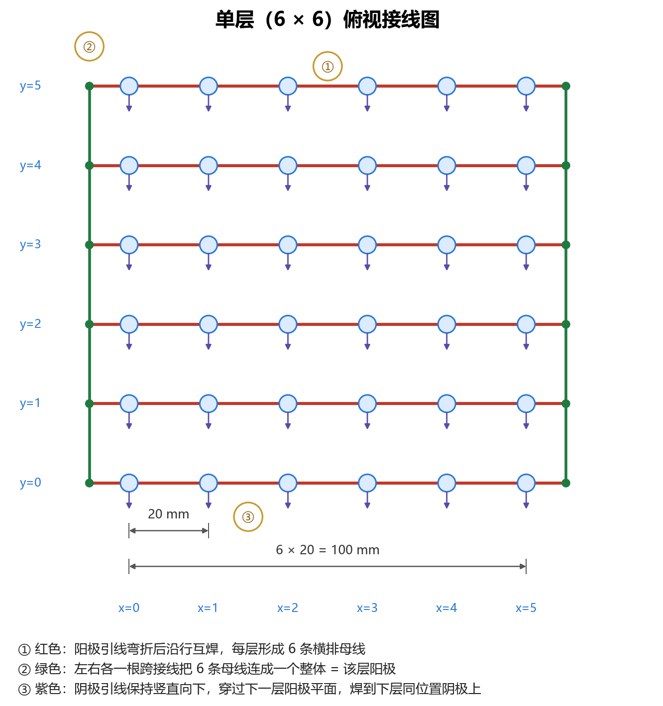
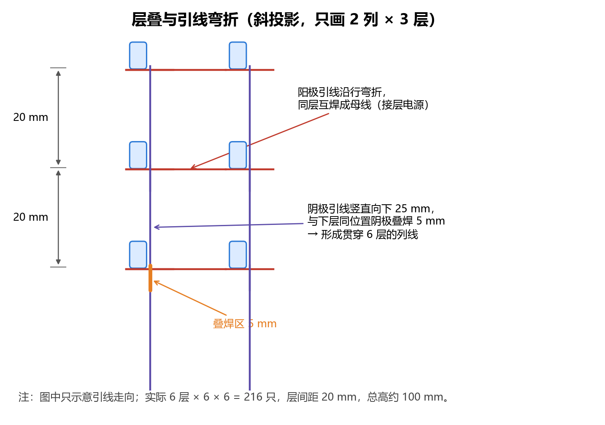

# 02 · 制作步骤

> 这是整个项目最花时间的部分。**每做完一层就测，不要全部焊完再测** —— 216 只灯里返工一只都是折磨。

---

## 0. 工具与材料

| 工具 | 说明 |
|:--|:--|
| 电烙铁 | 尖头（0.8–1.2 mm），30–40 W 或可调温；温度 330 °C 左右 |
| 焊锡丝 | 0.6 mm 含铅/无铅均可，无铅建议带助焊剂 |
| 斜口钳 | 剪灯脚，要锋利 |
| 尖嘴钳 / 镊子 | 弯脚时夹住根部，保护灯体 |
| 万用表 | 通断档 + 二极管档 |
| 测试电源 | 3 V 纽扣电池 + 100 Ω，或 5 V + 1 kΩ，用来逐只点灯 |
| 夹具 | 见第 2 步；配套 A4 1:1 钻孔图：[docs/夹具图纸_A4_1比1.pdf](docs/夹具图纸_A4_1比1.pdf) |
| 堆叠垫块 | 4 个 20 mm 见方的小木块/3D 打印块 |
| 标签纸 / 美纹纸 | 给 36 根列线做标记 |

材料：

| 材料 | 数量 | 说明 |
|:--|:--:|:--|
| F3 蓝光 LED | **240 只** | 多买 10% 备用、挑一致性 |
| 0.5 mm 镀锡铜线 | 若干 | 做母线跨接和引出线 |
| 150×150×T 夹具板 | 1 | T = 2–3 mm，见第 2 步 |
| 底座板 120×120 mm | 1 | 亚克力/木板，固定立方体 |

---

## 1. 第 0 步：逐只测灯（必做）

买来的灯里**一定有几只坏的或明显偏暗的**。装进立方体后再发现，就得拆层。

做法（任选）：

**A. 纽扣电池法**（推荐，快）
1. 一颗 CR2032 是 3 V，蓝灯 Vf 约 3.0 V，能微亮（太暗看不清就改用 C 法）。
2. 串一个 100 Ω：`电池 + → 100Ω → LED 长脚 → LED 短脚 → 电池 −`。
3. 亮的留，不亮/明显暗的挑出来。

**B. 万用表二极管档**：很多表测试电压只有 2–3 V，蓝灯可能点不亮，不准。

**C. 5 V + 1 kΩ**：`5V → 1k → LED → GND`，约 1.8 mA，能看清亮度一致性。

> 建议同时按亮度分 2–3 档，同一层用同一档，成品看起来更均匀。216 只大约需要 40–60 分钟。

---

## 2. 第 1 步：做夹具

夹具决定整个立方体的精度，**别省这一步**。

### 2.1 尺寸

- 孔距（层内点间距）：**20 mm**
- 孔数：**6 × 6 = 36**
- 孔径：**3.0–3.2 mm**（灯珠法兰卡在板面不掉）
  - 如果买到的是**无法兰的圆柱形 3 mm 灯**，用 3.0 mm 孔紧配，或在夹具上贴一层胶带增加摩擦
- 板厚：**2 mm 最理想**（3 mm 也可以）
- 成品尺寸：5 × 20 = **100 mm** 见方

### 2.2 打印钻孔图

`docs/夹具图纸_A4_1比1.pdf` 已经按真实尺寸画好：

1. 打印时务必选 **100% / 实际大小**，**不要**“适应页面”；
2. 打印后用尺子量一下图上的 50 mm 标尺，确认没缩放；
3. 把纸贴在板上，用锥子/钉子在每个十字中心打定位坑，再用 3.2 mm 钻头钻穿。

### 2.3 引线长度校核（很重要）

本项目的做法是：**灯体在上面、灯脚在板子下面**，阳极在板下弯折，阴极竖直穿过孔往下伸。
两个约束：

```
① 阴极叠焊长度 = 灯脚总长 L − 层距 P     → 要 ≥ 3 mm
② 阳极弯折后能横伸的长度 = L − 板厚 t    → 要 ≥ 21 mm（灯距 20 mm + 1.5 mm 搭接）
```

| 灯脚总长 L | 板厚 t | 建议层距 P | 叠焊长度 |
|:--:|:--:|:--:|:--:|
| 25 mm | 2 mm | **20 mm** | 5 mm |
| 25 mm | 3 mm | **20 mm** | 5 mm |
| 27 mm | 3 mm | 20–22 mm | 5–7 mm |

本项目按 **20 mm** 画。若你的灯脚只有 22 mm，把层距改成 **18 mm**（立方体约 90 mm），
其余不变；实在不够，就在每个叠焊点补一段 5 mm 短铜线。

### 2.4 标记方向

在夹具背面用记号笔标：

- 一个角写 **`(0,0)`**
- 沿边写 `x →`、`y →`

6 层都要用同一块夹具、同一个方向，否则层与层对不上。

---

## 3. 第 2 步：做一层（36 只灯）





> **打印用工艺卡**：[docs/焊接工艺卡_A4.pdf](docs/焊接工艺卡_A4.pdf) —— 2 页 A4：
> 第 1 页 参数/两条铁律/俯视/剖面/四步/检查清单，第 2 页 逐层记录表 + 42 张线缆标签（剪下贴引线）。

> **3D 模型**（可直接旋转查看怎么焊）：`docs/cad/` 里有 `layer_6x6.stl`（单层）、
> `cube_6x6x6.stl`（整体）、以及俯视/剖面/四步工艺图，说明见 `docs/cad/README.md`。

### 3.1 架夹具、插灯（方向必须一致）

1. 把夹具架在两块木块上，距桌面约 **15 cm**，让**板子背面完全悬空**，人在旁边可以从下往上焊。
2. **从上方插灯**：灯体在上，靠法兰卡在板面，**灯脚全部穿到板下**（无法兰的灯会松，插完用一条胶带临时压住）。
3. **所有灯方向一致，两脚沿 y 方向错开**：从上方看，**长脚（阳极）统一朝 −y，短脚（阴极）朝 +y**。
   - 判极性：长脚 = 阳极；灯体侧面**平边** = 阴极。
   - ⚠️ **两脚必须垂直于弯折方向错开**：阳极是沿 **x** 弯折的，如果两脚也沿 x 排（长脚在左、短脚在右），
     弯过去的阳极会在 2.54 mm 处**直接压在隔壁那根阴极脚上短路**。沿 y 错开后，
     阳极母线走在 y−1.27 那条线上，阴极在 y+1.27，两条线永不相交。
4. 插满 36 只后，逐只轻轻压一下，确保法兰都贴紧板面（这决定层内平整度）。

> 做完后不需要翻转：把整层**向上提起**，灯脚从孔里滑出、夹具留在木块上，得到的正好是“灯体在上、灯脚朝下”的正方向。

### 3.2 焊阳极母线（沿 x 方向，在板下操作）

对每一行 y = 0…5：

1. 用尖嘴钳夹住灯脚根部，把**阳极（长脚）沿 +x 向右掰 90°**（弯 21.5 mm），贴着板子的下表面平放；
2. 掰平后它正好**搭到右边相邻灯的阳极脚上**（末端多出 1.5–3 mm），在交叉点焊住，焊锡把两根脚一起包住；
3. 逐对点焊：共 5 个焊点 / 行；
4. 一行焊完就是一条横排母线；
5. 剪掉多余的脚（留 1 mm 左右）。

> 最右边那只灯的阳极脚没有邻居，**先别剪**，留着当跨接点。

### 3.3 跨接 6 条母线

用镀锡铜线沿 **y 方向**把 6 条母线连起来：

- 走两根，位置选在两列灯之间（例如 **x ≈ 10 mm** 和 **x ≈ 90 mm**），这样不会碰到任何阴极脚；
  （注意：x=20/80 是灯的列位置，走那里会从灯脚中间穿过）
- 每经过一条母线就焊一次，共 6 个焊点 × 2 根；
- 焊完后这一整层就是一个电气节点 —— **该层阳极**。

> 图 2 为了画得清楚把跨接线画在最外侧；实际施工走两列灯之间更好焊、也更安全。

### 3.4 检查这一层

1. 目视：有没有焊锡连到旁边的阴极脚？有没有虚焊？
2. 万用表通断档：任意两个阳极脚之间都应该是通的（< 1 Ω）。
3. 逐只点灯：3 V 电池串 100 Ω，**正极接阳极母线，负极依次碰每个阴极脚**，36 只都该亮。
   - 不亮的：极性反了 / 虚焊 / 坏灯 → 现在就换掉。
4. 全部通过后，把整层**向上提起**，让灯脚从夹具孔里滑出（夹具留在木块上）。此时已经是“灯体在上、灯脚朝下”，直接平放即可，**不需要翻转**。
5. 用记号笔在阳极母线的线头处标上层号 `L0…L5`，并把该层的阳极引出线焊好（后面用）。

> 每层阳极只需要 **1 根引出线**，从母线任意位置焊出，长度留到驱动板。

---

## 4. 第 3 步：堆叠

### 4.1 准备

- 底座板（120×120）上做 4 个角柱，柱上按 **每 20 mm 一道刻线/卡槽**，共 5 道；
- 角柱位置在立方体四角**外侧**，不能压到灯位；
- 或者更简单：准备 4 个 20 mm 高的垫块，四角轮流垫。

### 4.2 放第 0 层

1. 第 0 层（灯脚朝下）放在底座上，四面与角柱贴平；
2. **它的 36 根阴极脚继续向下**，就是将来接驱动板的列线 —— 先别剪短，长度留到能碰到驱动板；
3. 用标签纸给每根阴极脚标上 `x,y`（6 根一排，按 x=0…5、y=0…5 顺序）。

### 4.3 叠第 1–5 层（每层都重复）

1. 在四角垫上 20 mm 垫块，把上一层放上去，四边贴紧角柱；
2. **对齐**：从侧面看，上层每根阴极脚应该正好贴在下层同位置阴极脚的旁边（同一 (x,y)）；
   - 先看四个角，再看中间；
   - 有偏差就轻推层板，别硬掰灯脚。
3. 焊接：**先焊对角两个点**定位，再检查一次垂直度，然后逐点焊（36 个点）；
   - 烙铁同时加热两根脚，加一点点锡，形成一个小锡球；
   - 每个点 1 秒左右，别烤太久；
4. 剪掉多余的脚（留 1 mm）；
5. 目视检查：**上层的阴极不能碰到下层的阳极母线**（距离只有 2.54 mm，锡渣很容易搭上）；
6. 重复到第 5 层。

> 每焊完一层，用万用表确认：6 条层阳极之间互不相通；任意两根列线之间不相通。
> 一旦短路，越往后越难查。

### 4.4 引出 6 根层线

每层阳极各焊一根 0.5 mm² 线（约 25 cm），统一从**同一侧**引出，标 `L0…L5`。

---

## 5. 第 4 步：接驱动板（100×100 底座板）

驱动板已画好：**顶面朝立方体，只有 42 个通孔焊盘；器件全部贴底面**（见 `docs/驱动板布局预览.png`）。

1. **36 根列线（阴极）** → 顶面 6×6 焊盘阵列，间距 15 mm、居中布置。
   立方体的列是 20 mm 间距，所以每根引线向板中心收一点（最大约 12 mm），用铁丝焊上去即可。
2. **6 根层线（阳极）** → 顶面下方一排 `L0…L5` 焊盘（10 mm 间距，板边丝印已标）。
3. 板子四角是 **M3 螺丝孔**，装在底座或立柱上。
4. 5 V 电源接底面 `H5`（1×2 排针），ESP32 直接插底面 `H8/H9`（1×15 排针）。

顶面焊盘与坐标的对应（丝印 `ROW0…ROW5` = y）：从下往上看时，**焊盘 `C{行}{列}`**，
行 = y（0 在最下面那层），列 = x（0 在左边）。接之前先按 `ROW0…ROW5` 把 36 根线分好组，
焊错一根就是一个点位置偏移，改固件里的映射也可以补救（见 `03_固件与使用.md`）。

标签对照：

| 立方体引线 | 驱动板 / 原理图 |
|:--|:--|
| 列 (x, y) | 顶面焊盘 `C{y}{x}` → 行寄存器 y 的 Q(x+1) |
| 层 L0…L5 | 顶面 `L0…L5` 焊盘 → 层开关 Q1…Q6（L0 是最下面那层） |

---

## 6. 第 5 步：上电与自检

1. 先不接 LED，只给 ESP32 上电，串口应打印帮助信息；
2. 接上驱动板，**上电瞬间立方体必须是全灭**（如果不灭，说明驱动的层极性反了，改驱动或改固件一行）；
3. 串口发 `s`：应全部最亮；
4. 串口发 `d`：6 层从下到上应逐级变亮，可数出 16 级灰度；
5. 串口发 `t`：逐点点亮（216 点约 26 秒），对照实际位置检查：
   - 位置对不上（镜像/旋转）→ 在固件里改映射，见 `03_固件与使用.md`；
   - 某一层不亮 → 检查该层阳极线 / 层开关；
   - 某一行或一列全不亮 → 检查对应列线 / 驱动通道。

---

## 7. 常见故障排查

| 现象 | 可能原因 | 处理 |
|:--|:--|:--|
| 单个灯永远不亮 | 极性装反 / 虚焊 / 坏灯 | 换灯，或补焊 |
| 一只灯常亮（不受控） | 该灯阴极与阳极母线短路 | 找到短路点，吸锡重焊 |
| 一整行不亮 | 该行阳极母线断了 / 跨接线漏焊 | 通断档查母线 |
| 整列不亮 | 该列阴极断 / 驱动通道坏 | 万用表从列线倒推到驱动输出 |
| 整层不亮 | 层阳极线断 / 层开关坏 / 层位反了 | 先查线，再查极性 |
| 画面整体镜像 | 列线顺序接反 | 固件里交换 x 或 y（不用拆） |
| 某一层明显偏暗 | 该层开关压降大 / 层线太细 | 换 MOS、加粗层线 |
| 灰度不线性（低亮跳变） | 移位时间补偿失效 | 看串口打印的“单个子场开销”，异常就重测 |
| 闪烁/条纹 | 刷新太慢或被串口阻塞 | 降低动画频率、别在循环里 delay |
| 上电就全亮 | 层极性理解反了（0 = 亮） | 改驱动，或改固件 `renderPlane()` |

---

## 8. 焊接要点（少走弯路）

1. **弯脚先夹根部**：用尖嘴钳夹住灯脚贴近灯体的位置再弯，否则会把灯脚从环氧体里拽出来。
2. **一个点 1 秒**：蓝灯不怕短时高温，但灯体塑料会变形；焊完松手等 1 秒再动。
3. **不要用酸性助焊剂**，残留会腐蚀；用完用酒精+棉签清理。
4. **每层焊完就拍照**：返工时能对照。
5. **先少后多**：先焊 2×2 的四只灯练习手感，熟练了再上整层。
6. 焊锡不要贪多，小锡球足够；大坨锡容易连到隔壁脚。

---

## 9. 时间分配参考

| 阶段 | 时间 |
|:--|:--:|
| 测灯 + 分选（216 只） | 0.7–1 h |
| 做夹具 | 0.5–1 h |
| 单层制作（36 只）× 6 | 每层 1–1.5 h，共 6–9 h |
| 堆叠焊接 | 1.5–2 h |
| 引线 + 装底座 | 0.5–1 h |
| 联调排故 | 1–2 h |
| **合计** | **约 10–12 h** |
